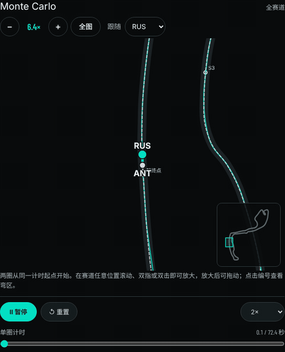
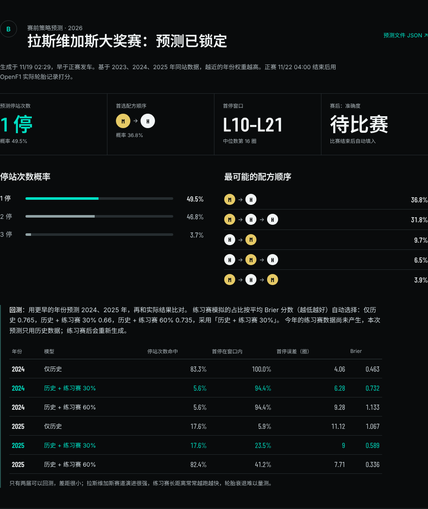

# Raceopic

**Where does the lap time between two Formula 1 drivers actually come from?** Raceopic answers that with real timing and telemetry: pick a race and two drivers, and it lines up their qualifying laps on the track map, their race pace lap by lap, and their tyre strategies — and before each race it commits a strategy forecast that is scored once the race is over.

**Live site: https://larmeinsamkeit-bot.github.io/raceopic/** · [中文说明](#中文说明)


## What it does

- **Track map with three views.** Sector advantage coloured by who was faster, both drivers' racing lines, and a synchronized two-car replay of their qualifying laps.
- **Zoom anywhere on the circuit.** Scroll or pinch over any corner to zoom in there, drag to pan, double-click to dive in, and let the camera follow a car during the replay. A minimap shows where you are.
- **Race pace on one lap axis.** Lap times, a per-lap delta strip ("faster on N laps") and tyre stints share the same x axis, with outlier laps (starts, pit laps, safety cars) excluded by default.
- **Pit-stop what-if.** A dry-race model fitted on the whole field estimates what moving one stop would have cost or gained.
- **Shareable comparisons.** The URL carries race, drivers, qualifying laps and view, e.g. [`?race=brazil&a=VER&b=NOR&mode=replay`](https://larmeinsamkeit-bot.github.io/raceopic/?race=brazil&a=VER&b=NOR&mode=replay).
- **2026 season.** Calendar, driver and constructor standings after every round, classifications, and per-round OpenF1 race archives.



## Pre-race strategy forecast

Before a race, `data-tools/predict_strategy.py` writes a forecast of the stop count, compound sequence and first-stop window, and the file is committed **before lights out** — the commit time is the proof the forecast was blind. After the race the same script scores it against the real stints.

The forecast blends two models:

1. **History prior** — recency-weighted strategy frequencies from earlier editions of the same race.
2. **Practice simulation** — tyre degradation measured from this weekend's practice long runs, compound pace and pit loss from last year's race, then every one- and two-stop plan simulated; plans close to the fastest become probabilities.

The blend weight is not hand-picked: the script backtests each earlier edition and uses the weight with the lowest mean stop-count Brier score. For Las Vegas it currently picks 30% practice:

| Backtest | Model | Stop count correct | First stop in window | First-stop error | Brier |
|---|---|---:|---:|---:|---:|
| 2024 | history only | 83.3% | 100% | 4.1 laps | 0.463 |
| 2024 | history + 30% practice | 5.6% | 94.4% | 6.3 laps | 0.732 |
| 2025 | history only | 17.6% | 5.9% | 11.1 laps | 1.067 |
| 2025 | history + 30% practice | 17.6% | 23.5% | 9.0 laps | 0.589 |

Honest reading: two editions are not enough to claim the practice model is better — it helps 2025 (a one-stop race) and hurts 2024 (a two-stop race). Las Vegas has strong track evolution, so practice long runs often get *faster* with tyre age and degradation is hard to measure. The [2026 Las Vegas forecast](dist/predictions/2026-las-vegas.json) and every backtest row are shown on the season page, and the result will be added after the race on 22 November.



## Data

| Source | Used for |
|---|---|
| [OpenF1](https://openf1.org/docs/) | Race laps, sectors, stints, pit stops, race control, weather; practice long runs; qualifying telemetry for past seasons |
| [F1Archive](https://f1archive.org/docs) | 2026 qualifying position and car telemetry |
| [Jolpica F1](https://github.com/jolpica/jolpica-f1) | Calendar, standings and classifications |

The site is static and ships data snapshots in `dist/`:

- `dist/lab-2026/` — one file per completed 2026 round (race timing plus up to four qualifying laps per driver), loaded when the round is picked.
- `dist/past/` — selected earlier races (five qualifying laps per selected driver), also loaded on demand.
- `dist/season-2026.json`, `dist/season-2026/` — season standings and per-round race archives.
- `dist/predictions/` — pre-race forecasts and, after the race, their scores.

## Run locally

```sh
python3 -m http.server 8765 --directory dist
```

Then open http://localhost:8765. Everything is plain HTML, CSS and JavaScript; the data tools use only the Python standard library.

## Refresh the data

Each step needs network access; use fresh cache folders to pick up revised data.

```sh
python3 -B data-tools/pull_openf1.py --cache /tmp/raceopic-archive
python3 -B data-tools/build_dataset.py /tmp/raceopic-archive dist/past
python3 -B data-tools/pull_season.py --cache /tmp/raceopic-2026 --output dist all
python3 -B data-tools/build_season_lab.py --cache /tmp/raceopic-season-lab --dist dist
```

`build_dataset.py` keeps past races already in `dist/past/` when their downloads are not in the cache, so one race can be added on its own. `build_season_lab.py --laps N` sets how many qualifying laps to keep per driver.

Strategy forecast (run `predict` before the race, `evaluate` after it):

```sh
python3 -B data-tools/predict_strategy.py predict --cache /tmp/raceopic-predict --output dist/predictions/2026-las-vegas.json
python3 -B data-tools/predict_strategy.py evaluate --cache /tmp/raceopic-predict --output dist/predictions/2026-las-vegas.json
```

## Tests and deployment

```sh
python3 -B -m unittest discover -s data-tools/tests -v
```

CI (`.github/workflows/ci.yml`) runs the unit tests, syntax-checks every site script and validates all site data. Pushing to `main` publishes `dist/` to GitHub Pages (`.github/workflows/pages.yml`).

Raceopic is an independent data project and not an official Formula 1 product.

---

## 中文说明

Raceopic 是一个 F1 数据分析网站，回答一个问题：**两位车手之间的圈速差，到底来自哪里？** 选择比赛和两位车手，就能在赛道图上对比排位圈的分段优势、行车线和双车回放，并按圈比较正赛节奏与轮胎策略。

**网站：https://larmeinsamkeit-bot.github.io/raceopic/**

- **赛道图**：分段优势、行车线、双车同步回放。可在赛道任意位置滚动、双指或双击放大，拖动平移，回放时镜头可跟随车手，并有小地图显示当前位置。
- **正赛节奏**：圈速、每圈差值与轮胎时间线共用同一条圈数轴，默认排除发车圈、进出站圈和安全车圈。
- **进站情景**：用全场数据拟合的干地模型，估算换一圈进站的得失。
- **可分享链接**：网址会记录赛事、车手、排位圈和模式。
- **2026 赛季**：赛历、每轮后的车手与车队积分、分类成绩与各站 OpenF1 正赛档案。

### 赛前策略预测

`data-tools/predict_strategy.py` 在正赛前生成停站次数、配方顺序和首停窗口的预测，并在发车前提交到仓库，提交时间就是盲测证明；赛后用实际轮胎记录打分。

预测混合两个模型：往年同站的策略频率（越近权重越高），以及用本周末练习赛长距离的轮胎衰退、去年正赛的配方速度和进站损失模拟所有一停与两停方案。混合比例由回测自动选择（平均 Brier 分数最低者），目前为练习赛 30%。只有 2024、2025 两届可以回测：练习赛模型改善了 2025 年（一停赛），却拖累了 2024 年（两停赛），样本太少，不能宣称一定更准。拉斯维加斯赛道演进很强，练习赛长距离常常越跑越快，轮胎衰退难以量测。所有回测结果都显示在赛季页，11 月 22 日赛后会补上实际准确度。

### 本地运行、更新数据与测试

指令与上方英文部分相同：`python3 -m http.server 8765 --directory dist` 启动网站；`data-tools/` 下的脚本只用 Python 标准库；`python3 -B -m unittest discover -s data-tools/tests -v` 运行测试。推送到 `main` 后会自动部署到 GitHub Pages。

本站为独立数据项目，并非 F1 官方产品。
